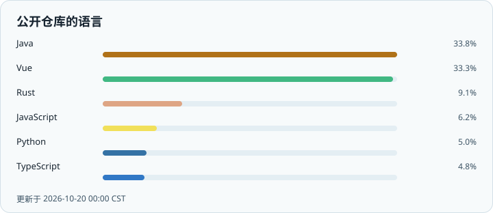
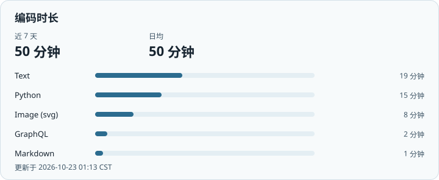
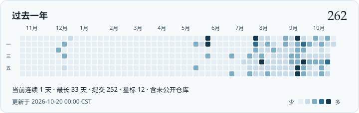

  <picture>
    <source media="(prefers-color-scheme: dark)" srcset="https://readme-typing-svg.demolab.com?font=Fira+Code&weight=500&size=24&duration=2600&pause=900&color=E7EEF4&center=true&vCenter=true&width=440&height=56&lines=Hi%2C+I'm+Adooooooo;Welcome+to+my+GitHub" />
    
  </picture>

  学生 · 热爱编程与人工智能 · 一切都是兴趣使然

## About me

- 大学学生 / College student
- 热爱开发、热爱 AI / Passionate about development and AI
- 一切都是兴趣使然 / Driven purely by curiosity
- 对动画、游戏、音乐感兴趣 / Interested in anime, games, and music

## 技术栈

  
  &nbsp;
  
  &nbsp;
  
  &nbsp;
  
  &nbsp;
  
  &nbsp;
  
  &nbsp;
  
  &nbsp;
  
  &nbsp;
  
  &nbsp;
  
  &nbsp;
  
  &nbsp;
  
  &nbsp;
  
  &nbsp;
  

## Github Statistics

  <picture>
    <source media="(prefers-color-scheme: dark)" srcset="./profile/languages-dark.svg" />
    
  </picture>

## WakaTime

  <picture>
    <source media="(prefers-color-scheme: dark)" srcset="./profile/wakatime-dark.svg" />
    
  </picture>

## Github Contribution

  <picture>
    <source media="(prefers-color-scheme: dark)" srcset="./profile/contrib-dark.svg" />
    
  </picture>

<!--
维护说明（这段注释不会出现在个人主页上）

页面仍是原来的五段：About me、技术栈、Github Statistics、WakaTime、Github Contribution。作品列表不放在主页上。

更新
- 工作流：.github/workflows/update-stats.yml
- 定时：每 6 小时一次，也可在 Actions 里手动运行 Update profile stats
- 本地试跑：设置 GH_TOKEN 或 PAT_TOKEN 后执行 python .github/scripts/generate_profile.py

密钥
- PAT_TOKEN：需要能读取你名下的仓库，包含未公开仓库。失效时工作流会改用 Actions 自带令牌，那种令牌看不到未公开仓库，脚本会保留上一版贡献图。
- WAKATIME_API_KEY：WakaTime 的 API Secret。缺失时保留上一版编码时长图。
-->
